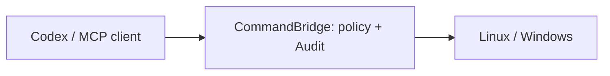

# CommandBridge MCP

Run commands and background jobs on Linux and Windows from Codex or another MCP client.

[](https://github.com/HsinPu/command-bridge-mcp-server/actions/workflows/ci.yml)


[繁體中文](README.zh-TW.md) · [Install](#one-command-installation) · [Connect Codex](#connect-codex) · [Uninstall](#one-command-uninstall) · [Guides](#guides)

Each host runs its own [MCP](https://modelcontextprotocol.io/) endpoint. Connect through local stdio or Streamable HTTP to inspect the host, run permitted commands, and review operation records.

## Features

- Three command modes: `allowlist`, `guarded`, and `unrestricted`.
- Background jobs with status, retained output, and cancellation; accepted jobs continue after client disconnect.
- Audit records and read-only diagnostics for troubleshooting.
- Optional SHA-256 verified file uploads/downloads in a private directory, up to 5 MiB per file, without overwriting.
- One-command service installation, startup at boot, and managed updates.



## One-command installation

**Windows:** x64 Windows 10/11 or Server, with administrator PowerShell. **Linux:** x64/ARM64 glibc, systemd as PID 1, and sudo. Installation needs access to GitHub, nodejs.org, and npm; Git and Node.js need not be preinstalled. See the platform guides for prerequisites and SELinux requirements.

### Windows

Run in administrator Windows PowerShell:

~~~powershell
$script = Join-Path $env:TEMP ("command-bridge-" + [guid]::NewGuid() + ".ps1"); try { Invoke-WebRequest -UseBasicParsing -ErrorAction Stop "https://raw.githubusercontent.com/HsinPu/command-bridge-mcp-server/main/scripts/bootstrap.ps1" -OutFile $script; & powershell.exe -NoProfile -ExecutionPolicy Bypass -File $script -ExecutionMode guarded -PrintCodexSetup; if ($LASTEXITCODE -ne 0) { throw "CommandBridge failed (exit $LASTEXITCODE)." } } finally { Remove-Item -LiteralPath $script -Force -ErrorAction SilentlyContinue }
~~~

### Linux

Run from your non-root login account:

~~~bash
(script="$(mktemp)" && trap 'rm -f -- "$script"' EXIT && curl -fsSL https://raw.githubusercontent.com/HsinPu/command-bridge-mcp-server/main/scripts/bootstrap.sh -o "$script" && sudo bash "$script" --run-as-installer --guarded --print-codex-setup)
~~~

The commands select **guarded**, start the service, enable startup at boot, and print Codex connection settings after MCP/Audit verification. Linux runs as your login account with its existing sudo permissions; Windows uses `LocalService`.

Application paths: Linux `/usr/local/lib/command-bridge`; Windows `%ProgramFiles%\CommandBridgeMCP`.

Installation uses a single source SHA from the CI-approved install channel, which may lag the version in this README. Reinstall preserves the Token and other settings but selects the mode from the supplied options. Use `update` to preserve the current mode.

## Connect Codex

1. Copy the installer-generated setup block into a trusted Codex task on the client computer.
2. Apply its connection name, URL, and token environment variable. Each host suggests `cb_<hostname>`; choose an unused name if it conflicts with an existing connection.
3. Restart Codex if needed, then verify the connection and ask it to run `hostname`.

Fresh installs detect a LAN/VPN IPv4, falling back to local-only `127.0.0.1`. Existing listener settings are preserved. HTTP is for trusted networks; **TLS and firewall rules are not configured automatically**. Keep the printed Token private.

To print the setup again on Linux:

```bash
sudo /usr/local/bin/command-bridge setup --show-token
```

Windows: run `& "$env:ProgramFiles\CommandBridgeMCP\command-bridge.cmd" setup --show-token` in administrator PowerShell. Without `--show-token`, setup hides the Token.

## Usage

| Capability | MCP tools |
| --- | --- |
| Host information and commands | `command_bridge_get_system_info`, `command_bridge_run_command` |
| Background jobs | `command_bridge_start_job`, `command_bridge_get_job`, `command_bridge_list_jobs`, `command_bridge_read_job_output`, `command_bridge_cancel_job` |
| Audit and diagnostics | `command_bridge_list_audit_events`, `command_bridge_get_diagnostics` |
| Optional file transfer | `command_bridge_upload_file`, `command_bridge_download_file` |
| Managed updates | `command_bridge_update`, `command_bridge_get_update_status` |

> Ask your connected client: “Show the host information, run hostname, and list the last 20 operation records.”

Use background jobs for long or verbose builds: they default to 30 minutes with a one-hour maximum. Saved output is truncated at its limit while the job continues; synchronous commands terminate at their output limit. See [background jobs](docs/background-jobs.md) for retry IDs and cancellation limits.

### Local commands

Linux host terminal:

```bash
command-bridge --version
command-bridge info --json
command-bridge update --check
sudo /usr/local/bin/command-bridge update
```

Windows uses `& "$env:ProgramFiles\CommandBridgeMCP\command-bridge.cmd"` with the same arguments; applying an update requires administrator PowerShell. Updates preserve settings and validate activation with rollback on failure. Fixed-purpose MCP updates are enabled by default on managed services. See [local administration](docs/local-administration.md) and [MCP updates](docs/mcp-update.md).

## Permissions and Audit

| Mode | Behavior |
| --- | --- |
| `allowlist` | Fixed programs with exact approved argument combinations; the unconfigured application default. |
| `guarded` | General commands with checks for recognizable deletion and system modifications; selected by the installers above. |
| `unrestricted` | Free-form shell execution under the service account's existing permissions; explicit opt-in. |

All modes check recognizable direct changes to CommandBridge itself. These checks prevent common mistakes; scripts, arbitrary programs, and full root sudo can bypass them. They are not a security sandbox. File transfer is independently disabled by default; enabling unrestricted does not enable transfers.

Commands require successful initial Audit; terminal Audit failure withholds output. Audit excludes stdout/stderr and masks common secret patterns, but is not tamper-proof. Linux uses the systemd journal or installer-account file Audit; Windows uses the `CommandBridgeMCP` Application Event Log source. Read records through the Audit tool; see [diagnostics](docs/diagnostics.md) if Audit is unavailable.

## One-command uninstall

### Windows

Run in administrator Windows PowerShell:

~~~powershell
$script = Join-Path $env:TEMP ("command-bridge-" + [guid]::NewGuid() + ".ps1"); try { Invoke-WebRequest -UseBasicParsing -ErrorAction Stop "https://raw.githubusercontent.com/HsinPu/command-bridge-mcp-server/main/scripts/bootstrap.ps1" -OutFile $script; & powershell.exe -NoProfile -ExecutionPolicy Bypass -File $script -Uninstall -Yes; if ($LASTEXITCODE -ne 0) { throw "CommandBridge failed (exit $LASTEXITCODE)." } } finally { Remove-Item -LiteralPath $script -Force -ErrorAction SilentlyContinue }
~~~

### Linux

~~~bash
(script="$(mktemp)" && trap 'rm -f -- "$script"' EXIT && curl -fsSL https://raw.githubusercontent.com/HsinPu/command-bridge-mcp-server/main/scripts/bootstrap.sh -o "$script" && sudo bash "$script" --uninstall --yes)
~~~

Uninstall removes the service and managed program files, including verified old Linux `/opt` deployments. It preserves configuration, Token, logs, work data, and job/update/recovery records. Full cleanup (`purge`) is documented in the platform guides; your installer login account is never deleted.

## Guides

| Topic | Documentation |
| --- | --- |
| Installation, paths, configuration, recovery | [Linux](docs/linux-systemd.md) · [Windows](docs/windows-service.md) · [Environment template](.env.example) |
| Jobs and administration | [Background jobs](docs/background-jobs.md) · [Local commands](docs/local-administration.md) · [Temporary access](docs/temporary-access.md) |
| Command policies | [Guarded mode](docs/guarded-mode.md) · [Self-protection](docs/self-protection.md) · [Legacy allowlist migration](docs/migration-1.0.md) |
| Transfers and operations | [File transfer](docs/file-transfer.md) · [Text encoding](docs/text-encoding.md) · [MCP updates](docs/mcp-update.md) · [Diagnostics](docs/diagnostics.md) |
| Changes and support | [Changelog](CHANGELOG.md) · [Validation status](docs/validation-status.md) · [Issues](https://github.com/HsinPu/command-bridge-mcp-server/issues) · [Security reporting](SECURITY.md) |

## Development

Built with TypeScript, Node.js ≥20, the MCP SDK, Express, and Zod. Read [AGENTS.md](AGENTS.md); use `npm ci` and `npm test` to build and check the source. Local stdio development uses [.env.example](.env.example) and `npm run dev`. Never commit tokens or local `.env` files.

License: this repository currently has no `LICENSE` file or package license declaration.
