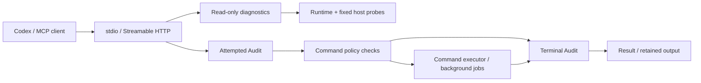

# CommandBridge MCP

**Run policy-controlled commands and background jobs on Linux and Windows from Codex or another MCP client.**

[](https://github.com/HsinPu/command-bridge-mcp-server/actions/workflows/ci.yml)


[繁體中文](README.zh-TW.md) · [Install](#one-command-installation) · [Connect Codex](#connect-codex) · [Configuration](#configuration) · [Tools](#mcp-tools) · [Background jobs](#background-command-jobs) · [Security](#command-restrictions-and-security-boundaries) · [Uninstall](#one-command-uninstall) · [Changelog](CHANGELOG.md)

CommandBridge is a [Model Context Protocol (MCP)](https://modelcontextprotocol.io/) server deployed on the host you want to manage. It gives AI clients a consistent interface for inspecting the host, running permitted commands, tracking finite background jobs, transferring files when enabled, and reviewing operation records without requiring SSH as the connection method.

Each host runs its own MCP endpoint. The server supports local `stdio` and remote Streamable HTTP; the one-command installers below create an HTTP background service that starts at boot.

> [!NOTE]
> Installation uses a fixed bootstrap URL and the latest main commit that passed every CI release gate, including service installation checks. All downloaded application assets use that same full source SHA. Missing or invalid channel information stops installation; there is no fallback to unverified main. The README version describes this checkout and may be ahead of the published install channel. Tags are optional historical references; see the [changelog](CHANGELOG.md) for version history and the [1.0 migration guide](docs/migration-1.0.md) for legacy custom allowlists.

## What can you do with it?

| Use case | CommandBridge capability |
| --- | --- |
| Inspect a host | Read operating system details, CPU count, memory, uptime, and effective execution policy. |
| Run diagnostics | Execute allowlisted commands such as `hostname`, `df`, and `Get-Process`. |
| Track long commands | Submit a build or other finite job, disconnect, then query status and retained output. |
| Exchange files | Opt in to verified uploads/downloads within a private transfer directory. |
| Work across platforms | Use the same MCP tools with each platform's command shell. |
| Review operations | Retrieve redacted command attempts, policy rejections, execution outcomes, and durations. |
| Deploy a persistent service | Download a runtime, build and test the source, install the service, and enable startup at boot. |

## Features

- **One-command deployment:** downloads CI-approved source and a checksum-verified runtime, then builds and validates the installation without a preinstalled Git or Node.js.
- **Automatic connection setup:** fresh installs can detect a LAN/Tailscale IPv4 address, configure the listener and allowed Host together, and print a host-specific Codex connection name and token environment variable.
- **Local installation queries:** inspect saved installation information and regenerate Codex setup in a host terminal; Token display requires an explicit administrator request.
- **Three execution modes:** exact-argument `allowlist`, general commands with recognizable-operation checks in `guarded`, or explicitly enabled `unrestricted`. The README installers select guarded; the application's unconfigured default is allowlist.
- **Background jobs:** policy checks, retry IDs, bounded queues, retained output, cancellation, and shared execution capacity for finite long-running commands.
- **Optional file transfer:** SHA-256 verification, a private directory, a 5 MiB file limit, and no overwriting or automatic execution.
- **Audit and diagnostics:** command lifecycle records, secret masking, bounded diagnostic summaries, and explicit degraded status for unconfirmed termination. Initial Audit failure prevents execution; terminal Audit failure withholds output.
- **Service accounts:** the Linux command below uses the installing login account and its existing permissions; a dedicated account is also available. Windows uses `LocalService`.
- **Managed updates:** local commands and fixed-purpose MCP update jobs use the verified channel, preserve settings, and validate activation before completing an upgrade.
- **Configuration preservation:** reinstalls retain configuration and tokens, with recovery mechanisms for failures during upgrade activation. Linux verifies backups before replacing files; incomplete recovery stops restart and retains private recovery records for an administrator.

## How it works



HTTP connections require a Bearer Token and enforce the configured Host policy. Commands use the service account's operating-system permissions, pass Audit and execution-policy checks, and release results only after terminal Audit succeeds. Read-only diagnostics remain available during an Audit fault so administrators can identify the failure.

## Tech stack

TypeScript, Node.js (20 or newer), ES modules, the MCP SDK, Express, and Zod. Managed services use systemd on Linux and WinSW on Windows, with pinned runtime downloads and platform-native or private file Audit backends. See [Contributing](#contributing) for building the source locally.

## Requirements

| Platform | Environment |
| --- | --- |
| Windows | Windows 10/11 or Windows Server, x64, with an elevated Windows PowerShell session. |
| Linux | x64/ARM64, glibc, systemd as PID 1, and `sudo`; kernel and system libraries must meet the bundled Node.js requirements. |
| Network | Access to GitHub, nodejs.org, and the npm registry during installation; remote clients must be able to reach the host's address and service port. |

Alpine/musl is not supported. The systemd installer cannot run directly on Synology DSM. See the [Linux guide](docs/linux-systemd.md) and [Windows guide](docs/windows-service.md) for complete prerequisites.

On SELinux Enforcing/Permissive hosts, the installer requires `restorecon` and `matchpathcon`, repairs managed deployment labels, and uses a fixed host service entry while preserving the selected account and host policy. It does not disable SELinux or add allow rules. See the [SELinux recovery guide](docs/linux-systemd.md#selinux-hosts-and-recovery-from-203exec) and [validation status](docs/validation-status.md) for platform limits.

## One-command installation

Downloads GitHub source and Node.js, builds and tests the application, starts the service, and enables startup at boot. No preinstalled Git or Node.js is required. Without an explicit URL, a fresh install selects a LAN/Tailscale IPv4 address and prints Codex settings with the IP, port, and token. It falls back to a local-only address if none is found. Existing configuration is preserved.

### Windows

The command explicitly selects guarded on new installs and reinstalls; existing tokens and other settings are preserved.

Open Windows PowerShell as administrator (x64) and paste:

~~~powershell
$script = Join-Path $env:TEMP ("command-bridge-" + [guid]::NewGuid() + ".ps1"); try { Invoke-WebRequest -UseBasicParsing -ErrorAction Stop "https://raw.githubusercontent.com/HsinPu/command-bridge-mcp-server/main/scripts/bootstrap.ps1" -OutFile $script; & powershell.exe -NoProfile -ExecutionPolicy Bypass -File $script -ExecutionMode guarded -PrintCodexSetup; if ($LASTEXITCODE -ne 0) { throw "CommandBridge failed (exit $LASTEXITCODE)." } } finally { Remove-Item -LiteralPath $script -Force -ErrorAction SilentlyContinue }
~~~

### Linux

On a glibc Linux host with systemd (x64/ARM64), run this from your non-root login account. This command runs the service as that account and selects guarded mode on both new installs and reinstalls:

~~~bash
(script="$(mktemp)" && trap 'rm -f -- "$script"' EXIT && curl -fsSL https://raw.githubusercontent.com/HsinPu/command-bridge-mcp-server/main/scripts/bootstrap.sh -o "$script" && sudo bash "$script" --run-as-installer --guarded --print-codex-setup)
~~~

On Linux, the application and runtime are installed at `/usr/local/lib/command-bridge`, with the active release under `current`. Verified migration completely removes `/opt/command-bridge` and `/opt/command-bridge-mcp-server`, including old compatibility links; failure restores the original deployment. Configuration remains under `/etc`, work/state under `/var/lib`; the Token and existing Audit logs are preserved. Uninstalling first is unnecessary.

Run the one-command installer or `sudo /usr/local/bin/command-bridge update` from an administrator terminal for the first migration from an actual `/opt` deployment. Old-path scripts need updating; legacy MCP workers cannot perform this migration, while subsequent MCP updates remain supported. Reinstall downloads the CI-published source, so a newer `main` version is installable only after all release gates succeed. See [migration and location checks](docs/linux-systemd.md#checking-the-physical-program-location).

Installation starts `CommandBridgeMCP` on Windows or `command-bridge` on Linux and enables startup at boot. Activation requires health/readiness checks and real MCP command/Audit verification before upgrade backups are cleared. Startup configuration and a service restart do not establish that a physical reboot was tested. See the [platform guides](#documentation-and-feedback) for migration and recovery details.

The Linux command above uses `--run-as-installer --guarded`. New installations and reinstalls run as your login account with guarded preflight checks: general commands are available, while recognizable deletion and system modifications are rejected. Existing sudo permissions remain unchanged; no general sudo rights are added. Installation provisions only the fixed-purpose MCP updater and read-only diagnostic reader authorizations described below. This mode does not create a dedicated service user and uses private rotating file Audit. To use the dedicated-account mode on a fresh install, omit `--run-as-installer`.

**Each Linux installation selects the execution mode from its options.** Without `--guarded` or `--unrestricted`, it writes `COMMAND_BRIDGE_EXECUTION_MODE=allowlist`, including when upgrading an unrestricted installation. To retain unrestricted execution, explicitly pass `--unrestricted` together with `--run-as-installer` on every install. The README commands explicitly select guarded on reinstall; other settings such as tokens, network settings, custom roots and policy files are preserved; failed validation restores the prior settings. See [Return to allowlist mode](docs/linux-systemd.md#return-to-allowlist-mode). Unrestricted execution remains an explicit advanced choice described in the [platform guide](docs/linux-systemd.md#installer-account-mode); the allowlist is not a complete filesystem sandbox.

Installer-account mode does not create a dedicated `command-bridge` user. After the new service passes MCP/Audit verification, it detects and removes an unused local system account left by older releases, while keeping the policy-reader group and existing data. Unexpected account settings or running processes stop cleanup without deleting the account; see the platform guide for recovery details.

Linux copy-ready commands remove the temporary downloaded script on both success and failure. Installer exit cleanup removes only its own unpromoted deployment staging directories; installed runtimes, releases and data remain. Hard kills or power loss can leave temporary files.

## Connect Codex

After a successful installation, the terminal prints a marked block containing the actual endpoint URL, bearer token, and MCP settings:

```text
========== BEGIN COPY FOR CODEX ==========
MCP URL: http://192.168.1.20:8800/mcp
Codex connection name: cb_build01
Token environment variable: CB_BUILD01_TOKEN
Bearer token (secret): <generated or preserved token>
[mcp_servers.cb_build01]
enabled = true
url = "http://192.168.1.20:8800/mcp"
bearer_token_env_var = "CB_BUILD01_TOKEN"
startup_timeout_sec = 20.0
tool_timeout_sec = 480.0
========== END COPY FOR CODEX ==========
```

The IP and host name above are examples. Paste the complete installer-generated block into a trusted Codex task on the client computer and ask it to configure the connection. Each host gets a suggested `cb_<hostname>` alias and matching `<UPPERCASE_ALIAS>_TOKEN` client environment variable. If either already belongs to a different host, choose an unused alias and matching token variable without overwriting the existing connection. The installer cannot inspect the client computer; this check happens when applying the printed block. To set a stable or preferred alias, add `--codex-name cb_oracle_prod` on Linux or `-CodexName cb_oracle_prod` on Windows. Names must start with a lowercase letter and contain only lowercase letters, digits, or underscores (up to 64 characters). This changes the Codex client suggestion only; service and MCP tool names stay the same. Do not post the token in public issues or commit it to Git.

**A domain name is not required.** Without an explicit URL, a fresh installation prefers a private IPv4 address on a default-route interface, then looks for other private IPv4 addresses. If none is found, it falls back to `127.0.0.1`, which works only on the same host. Existing configuration files are not automatically changed to a newly detected IP.

Generated HTTP URLs are for a trusted LAN or VPN only. The installer does not provide TLS or open firewall ports. You can specify your own URL for an HTTPS reverse proxy or tunnel. If DHCP changes the address, update the service and client settings. See the platform guides for details.

## Configuration

Managed services load their saved environment file. Change protected service settings from an administrator terminal, then restart and verify readiness. The repository's [.env.example](.env.example) is for local development/stdio; do not overwrite an installed configuration with that template.

| Item | Linux | Windows |
| --- | --- | --- |
| Application and bundled runtime | `/usr/local/lib/command-bridge` | `%ProgramFiles%\CommandBridgeMCP` |
| Service configuration | `/etc/command-bridge/command-bridge.env` | `%ProgramData%\CommandBridgeMCP\command-bridge.env` |
| Service name | `command-bridge.service` | `CommandBridgeMCP` |

The following are defaults; explicit existing settings are preserved by `update`:

| Setting | Default and behavior |
| --- | --- |
| `COMMAND_BRIDGE_EXECUTION_MODE` | Application: `allowlist`; README installation commands: `guarded`. |
| `COMMAND_BRIDGE_HTTP_PORT` | `8800`; remote HTTP also requires a token of at least 32 characters and an allowed Host. |
| `COMMAND_BRIDGE_DEFAULT_TIMEOUT_MS` / `COMMAND_BRIDGE_MAX_TIMEOUT_MS` | `15000` / `300000` for synchronous commands. Requested timeouts are capped by the configured maximum. |
| `COMMAND_BRIDGE_MAX_OUTPUT_CHARS` | `50000`, shared by synchronous stdout/stderr; exceeding it terminates that command. |
| `COMMAND_BRIDGE_MAX_PARALLEL_COMMANDS` | `2`, shared by synchronous commands and background jobs. |
| `COMMAND_BRIDGE_AUDIT_TIMEOUT_MS` | `30000`; accepts integer `1000`–`60000` and includes queue time. |
| `COMMAND_BRIDGE_JOBS_ENABLED` / `COMMAND_BRIDGE_JOBS_ROOT` | Managed installation/update enables jobs and provisions private storage when these settings are missing. Explicit `true`/`false` is preserved; local npm/development use is opt-in. |
| `COMMAND_BRIDGE_JOBS_DEFAULT_TIMEOUT_MS` / `COMMAND_BRIDGE_JOBS_MAX_TIMEOUT_MS` | `1800000` / `3600000` (30 minutes / one hour). |
| `COMMAND_BRIDGE_UPLOAD_ENABLED` / `COMMAND_BRIDGE_DOWNLOAD_ENABLED` | `false`; transfer authorization is independent of command mode. |
| `COMMAND_BRIDGE_MCP_UPDATE_ENABLED` | `true` for managed services; npm/stdio has no privileged update worker. |

Shell defaults are `bash` on Linux and `powershell` on Windows. Administrators can configure allowed shells, working roots, exact command policies, Audit backends, and job storage in the [Linux](docs/linux-systemd.md) and [Windows](docs/windows-service.md) guides.

For a synchronous command lasting up to five minutes, request `timeoutMs: 300000`. Printed Codex setup uses `tool_timeout_sec = 480` to allow time for command execution and Audit. Custom longer limits require corresponding client settings; use [background jobs](#background-command-jobs) for long or verbose work.

## Check the installed version

Linux (4.2.0+):

```bash
command-bridge --version
```

Windows PowerShell:

```powershell
& "$env:ProgramFiles\CommandBridgeMCP\command-bridge.cmd" --version
```

`-V` also works. Queries use the bundled runtime and report the locally selected installed release; they do not start MCP/Audit, check service health, or contact GitHub. Older installations must upgrade first. npm users can use either `command-bridge --version` or the existing `command-bridge-mcp-server --version`.

## Retrieve installation and Codex settings

Use a host terminal:

```bash
command-bridge info --json
command-bridge setup
sudo /usr/local/bin/command-bridge setup --show-token
```

On Linux, use the full `/usr/local/bin/command-bridge` path with `sudo`: some hosts omit `/usr/local/bin` from sudo's `secure_path`, causing `sudo command-bridge` to report `command not found` even after a successful installation. The installer and updater leave the host's sudo search path unchanged. This fixed command follows the active release automatically, so you do not need to specify a version directory after updating.

Windows uses `& "$env:ProgramFiles\CommandBridgeMCP\command-bridge.cmd"` with the same arguments; `--show-token` requires an elevated PowerShell terminal. Ordinary queries hide the Token and do not write settings or depend on Audit. If protected settings are unreadable, use `sudo /usr/local/bin/command-bridge setup` (still hidden) or an elevated Windows terminal; `info` can return a partial summary. Saved connection names/HTTPS URLs survive reinstall and update. `setup --codex-name cb_other --codex-url https://private.example/mcp` changes only the output. Direct calls through MCP are blocked in every mode; use the MCP diagnostics tool for remote troubleshooting. See [local commands, permissions and metadata](docs/local-administration.md).

## Temporary administrator access

A host administrator can temporarily use `unrestricted` command execution without changing permanent configuration:

```bash
sudo /usr/local/bin/command-bridge access open --minutes 5
sudo /usr/local/bin/command-bridge access status
sudo /usr/local/bin/command-bridge access close
```

The default is 5 minutes, with an integer range of 1–60; the grant applies to all authenticated clients of this service. Expiry, close or service restart restores the configured mode for new commands; existing commands keep their original timeout. This does not add sudo rights or enable file transfers. MCP blocks recognizable direct calls to these management commands; arbitrary scripts with full root sudo remain outside that protection. Windows provides the same arguments through its installed `command-bridge.cmd` in an elevated terminal. See [temporary access, permissions and failure handling](docs/temporary-access.md).

## Update an installed service

Check the verified CI channel without changing the host:

```bash
command-bridge update --check
```

Update Linux from a separate administrator terminal:

```bash
sudo /usr/local/bin/command-bridge update
```

Windows: run `& "$env:ProgramFiles\CommandBridgeMCP\command-bridge.cmd" update --check`; apply `update` from an elevated PowerShell terminal. Updates preserve the existing service account, execution mode, Token, network, policy and work data. The service briefly restarts, and failed activation restores the previous deployment. Identical source SHA skips rebuilding/restarting. Only `--print-codex-setup` prints the Token. Earlier installations need one upgrade through the existing installer before this command exists. Re-running that installer still selects the execution mode from its arguments; `update` preserves it. npm installations use npm for updates. See the platform guides for details.

## MCP tools

| Tool | Purpose |
| --- | --- |
| `command_bridge_start_job` | Submit a policy-controlled background command with a retry UUID. |
| `command_bridge_get_job` | Read retained job state and Audit/termination status. |
| `command_bridge_list_jobs` | List bounded pages of job metadata. |
| `command_bridge_read_job_output` | Read output pages after terminal Audit and storage succeed. |
| `command_bridge_cancel_job` | Cancel queued work or request process-tree termination. |
| `command_bridge_get_diagnostics` | Read bounded service/Audit failure metadata and recent command summaries, even when Audit is unavailable. |
| `command_bridge_get_system_info` | Read host information and effective shell, command, working-directory, and concurrency policies. |
| `command_bridge_run_command` | Execute one command and return stdout, stderr, exit code, duration, and timeout/truncation status. |
| `command_bridge_list_audit_events` | Read recent audit events: 50 by default, up to 1,000 per request. |
| `command_bridge_upload_file` | Opt-in upload of a SHA-256 verified file to the private transfer directory; no overwrite. |
| `command_bridge_download_file` | Opt-in download of a regular file with size and SHA-256 metadata. |
| `command_bridge_update` | Request a fixed CI-channel service update; returns an independent job ID. |
| `command_bridge_get_update_status` | Query an update job or the latest job after reconnecting. |

MCP service updates are **enabled by default** on managed Linux/Windows installations. A Bearer Token holder can request an update, causing a brief service interruption. The root/SYSTEM worker accepts no custom source, command or installer arguments; it uses the verified CI channel and existing validation/rollback. Active background jobs or unconfirmed command termination block an update. An accepted request is not a completed update: reconnect and query its final status and source SHA. Set `COMMAND_BRIDGE_MCP_UPDATE_ENABLED=false` in the saved service configuration to disable requests. npm/stdio installations do not provision a privileged updater. See the [MCP update guide](docs/mcp-update.md).

### File transfer

File transfer is disabled by default, independently of command execution mode. Append `--enable-file-transfer` to Linux installation arguments or `-EnableFileTransfer` on Windows to enable both tools. Each file is limited to 5 MiB; only safe filenames directly inside the managed transfer directory are accepted. No subdirectories, links, URL fetching or automatic execution. See the [file transfer guide](docs/file-transfer.md) for separate permissions, storage, Audit and failure handling.

### Text output and file encoding

Command output defaults to UTF-8. Optional `outputEncoding` (`utf8`, `utf16le`, `big5`, `gbk`, `gb18030`) supports programs that emit another encoding; undecodable output is withheld with a clear error. Windows cmd uses a fixed UTF-8 console host, while native allowlist programs keep direct argv execution. File encoding is separate: use explicit UTF-8 file reads/writes in Windows PowerShell 5.1, and never reconstruct a document from garbled or truncated command output. Base64 transfers preserve original bytes, BOM and SHA-256 without transcoding. See the [Chinese text and migration guide](docs/text-encoding.md).

### Usage examples

Example requests for a connected client:

> Show this host's system information and currently allowed commands.
>
> Run hostname and tell me the result.
>
> Start a permitted build as a background job, save its job ID, and show the result when it finishes.
>
> List the last 20 operation records and identify rejected or failed commands.

## Background command jobs

Use background jobs for builds and other finite commands that outlast a single tool call. Submit with `command_bridge_start_job`, supplying a UUID `requestId`, then query/list/read output/cancel with the corresponding job tools. Reusing the same UUID and parameters returns the same retained job instead of starting it again; deduplication is limited to the record retention window (24 hours after completion). Accepted jobs continue after client disconnect and use the same command policies, service identity, and shared parallel limits.

Jobs default to 30 minutes with a one-hour host maximum; administrators can configure a maximum up to 24 hours. Requests above the job maximum are rejected. Running jobs expose progress metadata; output pages become readable after terminal Audit and safe storage succeed. Once retained output reaches its limit, capture is marked truncated and the process continues while output is drained. Synchronous commands still terminate at their output limit.

Restart interrupts jobs without automatically rerunning them. Cancellation does not guarantee Docker or another external daemon stops its work. Shared tokens can access all jobs in the service. Unconfirmed termination reserves its command slot, makes readiness fail, and appears as degraded diagnostics until cleanup is confirmed; remaining capacity can still accept commands. See [background jobs](docs/background-jobs.md) for storage, permissions, recovery, and when administrator intervention is required.

## Command restrictions and security boundaries

| Mode | Behavior |
| --- | --- |
| `allowlist` | Only configured commands and exact approved literal argument combinations. |
| `guarded` | General shell commands, with checks for recognizable deletion and system modifications. Selected by the README installers. |
| `unrestricted` | Free-form shell commands within the service account's existing permissions. Requires explicit selection or temporary administrator access. |

The default `allowlist` mode parses literal arguments, matches an exact approved argv combination, and launches a fixed executable without a shell. Built-in PowerShell cmdlets use a fixed wrapper. Linux defaults include `uname`, `hostname`, `df`, and `ps`; Windows defaults include `Get-Process`, `Get-Service`, and `systeminfo`. Built-ins allow no arguments by default; `Get-CimInstance` uses `Win32_OperatingSystem`. Custom commands require an administrator-managed policy file.

Deletion commands such as `rm`, `del`, and `Remove-Item` are absent from the default policies and are rejected. Enabling a custom native executable policy can permit destructive operations, and `unrestricted` explicitly restores free-form shell execution. None of the three modes is a complete filesystem sandbox.

> [!IMPORTANT]
> Administrators must trust the executable and every argument combination they approve. The service must not be able to modify its policy or approved binaries. Working-directory checks resolve symlinks, but arguments can still refer to other accessible paths. Keep the low-privilege account and network restrictions, and do not expose the service directly to the internet. See the [security policy](SECURITY.md).

The optional Linux installer-account mode deliberately grants MCP commands that login account's existing access. `--unrestricted` also removes the command allowlist; possession of the bearer token can then trigger any non-interactive command that account can run. Sudo commands requiring a password cannot be completed by the background service.

An always-on **command preflight guard** rejects recognizable direct writes to CommandBridge's own configuration, policy, application and service assets before starting a process. It applies to all modes and returns `SELF_MODIFICATION_BLOCKED` with an attempted/blocked Audit lifecycle. Existing sudo permissions remain unchanged. It prevents common accidents, **not indirect modification through scripts, variables, arbitrary programs or external root services**. Manage CommandBridge from a separate administrator terminal. See [self-protection](docs/self-protection.md).

Guarded mode returns a rule and Audit ID when it rejects a recognizable deletion or system change. Ordinary work-file writes and existing sudo permissions remain available; work files may still be overwritten, and external scripts/programs can bypass inspection. See [guarded rules and limitations](docs/guarded-mode.md).

## Read-only diagnostics

`command_bridge_get_diagnostics` is enabled by default. Use `{}` for 20 recent command summaries, `{"limit":100}` for the maximum, or `{"auditId":"<id>"}` to inspect one exact ID. It reports version, service state, active command slots, the first Audit fault and bounded storage/reader status without depending on Audit reads or writes. The last 100 command summaries are held in memory and disappear on restart; they contain no command text or stdout/stderr. Historical records remain in `command_bridge_list_audit_events`.

Audit-only startup failures retain authenticated diagnostics while `/ready` fails and new commands, transfers and updates remain blocked. Invalid configuration, policy or other dependencies still prevent startup; successful installation still requires real MCP/Audit verification. A stopped process, blocked network or frozen event loop requires an administrator terminal. See [diagnostic fields, limits and recovery](docs/diagnostics.md).

## Audit logging

Each command request entering the execution flow first records `attempted`, followed by `blocked`, `completed`, or `failed`. Events include the timestamp, audit ID, redacted command, shell, working directory, source, exit code, and duration.

| Platform | Where to look |
| --- | --- |
| Windows | Event Viewer → Windows Logs → Application, source `CommandBridgeMCP`. |
| Linux | Default service: systemd journal for `command-bridge`; installer-account service: `/var/lib/command-bridge-installer/CommandBridgeMCP/audit/events.jsonl` (rotating files). |
| MCP client | Call `command_bridge_list_audit_events`. |

Audit events do not store stdout/stderr, and common secret patterns in commands are redacted. Failure to write the initial event prevents execution; failure to write the terminal event withholds captured output. Retention is controlled by the host, and the logs are not tamper-proof.

Local stdio defaults to private JSONL files in the user's data directory, rotating at 10 MiB per file with five files retained. Services select journal, Event Log, or the Linux installer-account file backend. The authenticated `/ready` endpoint checks service dependencies; installation also verifies a real MCP command and matching audit lifecycle before discarding upgrade backups.

Confirmed process completion releases command slots even while terminal Audit is pending. Audit waits default to 30 seconds and accept `COMMAND_BRIDGE_AUDIT_TIMEOUT_MS=1000..60000`; a failure stops new commands and file transfers and makes `/ready` fail. Output still requires successful terminal Audit. An underlying disk operation may continue after timeout; resolve storage faults and restart the service before retrying.

Audit timeouts include queue time. Each command can require two Audit waits in addition to execution; use at least 120 seconds for ordinary client calls. Generated Codex setup uses 480 seconds for the standard five-minute command maximum and Audit settings up to 60 seconds. A longer wait does not repair full storage or permission failures; see the platform guides for recovery.

## One-command uninstall

Stops and removes the service and application, preserving configuration, token, and work data. Linux uninstall checks the new and both old roots before stopping services, removing verified program leftovers, managed migration backups and compatibility links together. Unrecognized contents or unsafe alias parents stop removal. A saved modern uninstaller is preferred; a missing required helper or an older script without full layout validation uses the fallback from one CI-pinned snapshot before any removal. An older channel that cannot validate all roots refuses removal and preserves the existing service.

### Windows

Open Windows PowerShell as administrator and paste:

~~~powershell
$script = Join-Path $env:TEMP ("command-bridge-" + [guid]::NewGuid() + ".ps1"); try { Invoke-WebRequest -UseBasicParsing -ErrorAction Stop "https://raw.githubusercontent.com/HsinPu/command-bridge-mcp-server/main/scripts/bootstrap.ps1" -OutFile $script; & powershell.exe -NoProfile -ExecutionPolicy Bypass -File $script -Uninstall -Yes; if ($LASTEXITCODE -ne 0) { throw "CommandBridge failed (exit $LASTEXITCODE)." } } finally { Remove-Item -LiteralPath $script -Force -ErrorAction SilentlyContinue }
~~~

### Linux

~~~bash
(script="$(mktemp)" && trap 'rm -f -- "$script"' EXIT && curl -fsSL https://raw.githubusercontent.com/HsinPu/command-bridge-mcp-server/main/scripts/bootstrap.sh -o "$script" && sudo bash "$script" --uninstall --yes)
~~~

Detailed settings and full data removal: [Windows guide](docs/windows-service.md) · [Linux guide](docs/linux-systemd.md).

Normal uninstall also preserves file Audit, retained background jobs, and update/recovery records. Use the platform guide's purge procedure when you intend to remove those records too; installer-account mode never deletes your login account or home directory.

## Documentation and feedback

- [Linux deployment guide](docs/linux-systemd.md): prerequisites, configuration, systemd operations, upgrades, and full removal.
- [Windows deployment guide](docs/windows-service.md): service configuration, Event Log, recovery, and full removal.
- [Local administration](docs/local-administration.md): installed version/source, saved connection settings, and administrator-only Token output.
- [Background jobs](docs/background-jobs.md): submission, retry IDs, limits, output, cancellation, and recovery.
- [Guarded mode](docs/guarded-mode.md) and [self-protection](docs/self-protection.md): command checks and their limits.
- [Temporary access](docs/temporary-access.md): administrator grants, expiry, and restoration.
- [File transfer](docs/file-transfer.md) and [text encoding](docs/text-encoding.md): permissions, safe storage, and byte preservation.
- [MCP updates](docs/mcp-update.md) and [diagnostics](docs/diagnostics.md): update status and remote fault inspection.
- [Environment template](.env.example): configurable environment variables; the application's local default is stdio, which differs from service installation settings.
- [Changelog](CHANGELOG.md): version changes and release status.
- [1.0 migration and policies](docs/migration-1.0.md): exact arguments, custom policies, audit backends, and network refresh.
- [Validation status](docs/validation-status.md): verified environments and remaining deployment limits.

## Contributing

Use Node.js 20 or newer; CI uses the pinned runtime documented in the platform guides. Read [AGENTS.md](AGENTS.md) before changing the source, then install dependencies and run the existing checks:

```sh
npm ci
npm test
```

`npm run build` creates `dist/`; `npm start` runs the built server. For local stdio development, copy [.env.example](.env.example) to `.env` and run `npm run dev`. Keep tokens and local configuration out of Git. Update both READMEs when user-facing behavior changes and record version changes in [CHANGELOG.md](CHANGELOG.md).

## License

This repository currently provides neither a `LICENSE` file nor a package license declaration.

## Support

Use [GitHub Issues](https://github.com/HsinPu/command-bridge-mcp-server/issues) for general problems and feature requests. Include the installed version, operating system, and error details with secrets removed. Report vulnerabilities privately as described in the [security policy](SECURITY.md); do not publish tokens or raw private logs.
