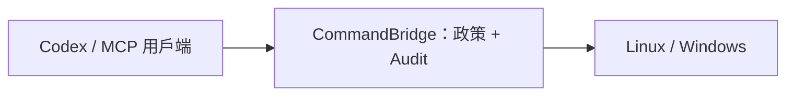

# CommandBridge MCP

讓 Codex 與其他 MCP 用戶端，在 Linux 和 Windows 執行指令與背景工作。

[](https://github.com/HsinPu/command-bridge-mcp-server/actions/workflows/ci.yml)


[English](README.md) · [安裝](#一鍵安裝) · [連線 Codex](#連線-codex) · [解除安裝](#一鍵解除安裝) · [操作指南](#操作指南)

每台主機各自執行一個 [MCP](https://modelcontextprotocol.io/) 端點，透過本機 stdio 或 Streamable HTTP，讓用戶端查詢主機資訊、執行允許的指令及查看操作紀錄。

## 主要功能

- 三種指令模式：`allowlist`、`guarded`、`unrestricted`。
- 背景工作可查狀態、讀取保存輸出及取消；接受後不因用戶端斷線而停止。
- Audit 操作紀錄與唯讀診斷，協助追查問題。
- 選用 SHA-256 驗證的檔案上傳／下載，限私有目錄、每檔最多 5 MiB，不覆寫。
- 一鍵安裝服務、設定開機啟動，並支援受管理更新。



## 一鍵安裝

**Windows：** x64 Windows 10／11 或 Server，使用管理員 PowerShell。**Linux：** x64／ARM64、glibc、systemd 為 PID 1，並可使用 sudo。安裝時需連到 GitHub、nodejs.org 與 npm，不需預先安裝 Git 或 Node.js。完整前置條件與 SELinux 需求見平台指南。

### Windows

在管理員 Windows PowerShell 執行：

~~~powershell
$script = Join-Path $env:TEMP ("command-bridge-" + [guid]::NewGuid() + ".ps1"); try { Invoke-WebRequest -UseBasicParsing -ErrorAction Stop "https://raw.githubusercontent.com/HsinPu/command-bridge-mcp-server/main/scripts/bootstrap.ps1" -OutFile $script; & powershell.exe -NoProfile -ExecutionPolicy Bypass -File $script -ExecutionMode guarded -PrintCodexSetup; if ($LASTEXITCODE -ne 0) { throw "CommandBridge failed (exit $LASTEXITCODE)." } } finally { Remove-Item -LiteralPath $script -Force -ErrorAction SilentlyContinue }
~~~

### Linux

從你的非 root 登入帳號執行：

~~~bash
(script="$(mktemp)" && trap 'rm -f -- "$script"' EXIT && curl -fsSL https://raw.githubusercontent.com/HsinPu/command-bridge-mcp-server/main/scripts/bootstrap.sh -o "$script" && sudo bash "$script" --run-as-installer --guarded --print-codex-setup)
~~~

指令會選擇 **guarded**、啟動服務及設定開機啟動，通過 MCP／Audit 驗證後印出 Codex 連線設定。Linux 使用登入者帳號與既有 sudo 權限；Windows 使用 `LocalService`。

程式位置：Linux 為 `/usr/local/lib/command-bridge`，Windows 為 `%ProgramFiles%\CommandBridgeMCP`。

安裝固定使用已通過 CI 的安裝頻道來源 SHA，可能比此 README 的版本稍晚。重新安裝會保留 Token 與其他設定，但依本次參數選擇模式；要保留目前模式，請使用 `update`。

## 連線 Codex

1. 將安裝器產生的完整設定區塊，貼到用戶端電腦上的受信任 Codex 工作。
2. 依內容設定連線名稱、URL 與 Token 環境變數。每台主機預設建議 `cb_<hostname>`；若名稱衝突，改用未占用的名稱。
3. 視需要重啟 Codex，確認連線後請它執行 `hostname`。

新安裝會自動選用區網／VPN IPv4，找不到時退回僅限本機的 `127.0.0.1`；既有監聽設定保留。HTTP 僅適用可信任網路，**不會自動設定 TLS 或開放防火牆**。請妥善保管印出的 Token。

Linux 再次印出連線設定：

```bash
sudo /usr/local/bin/command-bridge setup --show-token
```

Windows 在管理員 PowerShell 執行 `& "$env:ProgramFiles\CommandBridgeMCP\command-bridge.cmd" setup --show-token`；未加 `--show-token` 時會隱藏 Token。

## 使用方式

| 功能 | MCP 工具 |
| --- | --- |
| 主機資訊與指令 | `command_bridge_get_system_info`、`command_bridge_run_command` |
| 背景工作 | `command_bridge_start_job`、`command_bridge_get_job`、`command_bridge_list_jobs`、`command_bridge_read_job_output`、`command_bridge_cancel_job` |
| 稽核與診斷 | `command_bridge_list_audit_events`、`command_bridge_get_diagnostics` |
| 選用檔案傳輸 | `command_bridge_upload_file`、`command_bridge_download_file` |
| 受管理更新 | `command_bridge_update`、`command_bridge_get_update_status` |

> 可以對已連線的用戶端說：「查看主機資訊、執行 hostname，並列出最近 20 筆操作紀錄。」

長時間或大量輸出的建置請使用背景工作，預設 30 分鐘、上限一小時。保存輸出達上限時只截斷內容，工作繼續執行；同步指令則會因輸出超限終止。重試 ID 與取消限制見[背景工作指南](docs/background-jobs.md)。

### 本機指令

Linux 主機終端：

```bash
command-bridge --version
command-bridge info --json
command-bridge update --check
sudo /usr/local/bin/command-bridge update
```

Windows 使用 `& "$env:ProgramFiles\CommandBridgeMCP\command-bridge.cmd"` 搭配相同參數，套用更新須在管理員 PowerShell 執行。更新保留設定、驗證啟用結果，失敗則回復；受管理服務預設開啟固定 MCP 更新功能。詳見[本機管理](docs/local-administration.md)與 [MCP 更新](docs/mcp-update.md)。

## 權限與操作紀錄

| 模式 | 行為 |
| --- | --- |
| `allowlist` | 固定程式與精確核准的參數組合；程式未設定時的預設模式。 |
| `guarded` | 允許一般指令，檢查可辨識的刪除與系統修改；上方安裝指令使用此模式。 |
| `unrestricted` | 依服務帳號既有權限執行自由 Shell，須明確啟用。 |

所有模式都會檢查可辨識的直接自改操作。這是防止誤操作，腳本、任意程式或完整 root sudo 仍可能繞過，並非安全沙箱。檔案傳輸獨立預設關閉，啟用 unrestricted 不會開啟傳輸。

指令需先成功寫入初始 Audit，終結 Audit 失敗則不回傳輸出。Audit 不保存 stdout／stderr，會遮罩常見秘密，但不保證不可竄改。Linux 使用 systemd journal 或安裝者帳號的檔案 Audit；Windows 使用 Application Event Log 的 `CommandBridgeMCP` 來源。可透過 Audit 工具查詢，Audit 無法使用時請看[診斷指南](docs/diagnostics.md)。

## 一鍵解除安裝

### Windows

在管理員 Windows PowerShell 執行：

~~~powershell
$script = Join-Path $env:TEMP ("command-bridge-" + [guid]::NewGuid() + ".ps1"); try { Invoke-WebRequest -UseBasicParsing -ErrorAction Stop "https://raw.githubusercontent.com/HsinPu/command-bridge-mcp-server/main/scripts/bootstrap.ps1" -OutFile $script; & powershell.exe -NoProfile -ExecutionPolicy Bypass -File $script -Uninstall -Yes; if ($LASTEXITCODE -ne 0) { throw "CommandBridge failed (exit $LASTEXITCODE)." } } finally { Remove-Item -LiteralPath $script -Force -ErrorAction SilentlyContinue }
~~~

### Linux

~~~bash
(script="$(mktemp)" && trap 'rm -f -- "$script"' EXIT && curl -fsSL https://raw.githubusercontent.com/HsinPu/command-bridge-mcp-server/main/scripts/bootstrap.sh -o "$script" && sudo bash "$script" --uninstall --yes)
~~~

移除服務與受管理的程式檔，包含確認歸屬的 Linux 舊 `/opt` 部署；保留設定、Token、日誌、工作資料及背景工作／更新／回復紀錄。完整清除（purge）方式見平台指南，不會刪除安裝者登入帳號。

## 操作指南

| 主題 | 文件 |
| --- | --- |
| 安裝、位置、設定與回復 | [Linux](docs/linux-systemd.md) · [Windows](docs/windows-service.md) · [設定範本](.env.example) |
| 工作與管理 | [背景工作](docs/background-jobs.md) · [本機指令](docs/local-administration.md) · [臨時授權](docs/temporary-access.md) |
| 指令政策 | [Guarded 模式](docs/guarded-mode.md) · [自身保護](docs/self-protection.md) · [舊版白名單遷移](docs/migration-1.0.md) |
| 傳輸與維運 | [檔案傳輸](docs/file-transfer.md) · [文字編碼](docs/text-encoding.md) · [MCP 更新](docs/mcp-update.md) · [診斷](docs/diagnostics.md) |
| 變更與支援 | [更新紀錄](CHANGELOG.md) · [驗證紀錄](docs/validation-status.md) · [Issues](https://github.com/HsinPu/command-bridge-mcp-server/issues) · [安全回報](SECURITY.md) |

## 參與開發

使用 TypeScript、Node.js ≥20、MCP SDK、Express 與 Zod。先閱讀 [AGENTS.md](AGENTS.md)，再用 `npm ci`、`npm test` 安裝依賴、建置及檢查。本機 stdio 開發可搭配 [.env.example](.env.example) 與 `npm run dev`；不要提交 Token 或本機 `.env`。

授權：目前儲存庫沒有 `LICENSE` 檔案，套件也沒有宣告授權條款。
