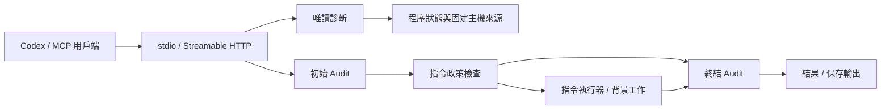

# CommandBridge MCP

**讓 Codex 與其他 MCP 用戶端，在 Linux 和 Windows 主機執行受政策限制的指令與背景工作。**

[](https://github.com/HsinPu/command-bridge-mcp-server/actions/workflows/ci.yml)


[English](README.md) · [一鍵安裝](#一鍵安裝) · [連線 Codex](#連線-codex) · [設定](#設定) · [工具](#mcp-工具) · [背景工作](#通用背景工作) · [安全](#指令限制與安全邊界) · [一鍵解除安裝](#一鍵解除安裝) · [更新紀錄](CHANGELOG.md)

CommandBridge 是部署在目標主機上的 [Model Context Protocol（MCP）](https://modelcontextprotocol.io/) Server。透過相同的工具介面，你可以讓 AI 用戶端查看主機資訊、執行允許的指令、追蹤有限時間的背景工作、在啟用後傳輸檔案，並查詢操作紀錄，不需要以 SSH 作為連線方式。

每台主機各自執行一個 MCP Endpoint。服務支援本機 `stdio` 與遠端 Streamable HTTP；下方的一鍵安裝會建立可開機啟動的 HTTP 背景服務。

> [!NOTE]
> 安裝採用固定 bootstrap 網址，來源是通過全部 CI 發布檢查（含真實服務安裝驗證）的 main commit，應用程式資產全部固定在同一完整 SHA。頻道資訊缺失或無效時停止，不會改抓未驗證的 main。README 版本代表目前原始碼，可能比安裝頻道更新。Tag 僅作歷史參考；版本歷史見 [更新紀錄](CHANGELOG.md)，舊版自訂白名單升級前請閱讀 [1.0 遷移指南](docs/migration-1.0.md)。

## 可以做什麼？

| 使用情境 | CommandBridge 提供的能力 |
| --- | --- |
| 了解主機狀況 | 查詢作業系統、CPU 數量、記憶體、開機時間與有效執行政策。 |
| 執行日常診斷 | 執行白名單內的指令，例如 `hostname`、`df`、`Get-Process`。 |
| 追蹤長時間指令 | 提交建置等有限時間工作，斷線後仍可查詢狀態與保存的輸出。 |
| 交換檔案 | 明確啟用後，在私有傳輸目錄內進行驗證過的上傳／下載。 |
| 同時維護 Linux 與 Windows | 使用一致的 MCP 工具，由各平台的 Shell 執行。 |
| 追查操作結果 | 查詢遮罩後的指令嘗試、政策拒絕、執行結果與耗時。 |
| 部署常駐服務 | 自動下載 Runtime、建置測試、安裝服務並設定開機啟動。 |

## 主要功能

- **一行部署**：下載通過 CI 的原始碼與驗證 checksum 的 Runtime，完成建置及安裝驗證，不需預先安裝 Git 或 Node.js。
- **自動連線設定**：新安裝可偵測區網／Tailscale IPv4，同步設定監聽位址與允許的 Host，輸出含主機專屬 Codex 連線名稱和 Token 環境變數的設定區塊。
- **本機安裝查詢：** 在主機終端取得儲存的安裝摘要及 Codex 設定；顯示 Token 須由管理員明確要求。
- **三種執行模式**：`allowlist` 精確核准參數、`guarded` 允許一般指令並檢查可辨識操作，或明確啟用 `unrestricted`。README 安裝指令選擇 guarded；程式未設定時預設為 allowlist。
- **通用背景工作**：提供政策檢查、重試 ID、有限佇列、輸出保存、取消及共用執行名額，適用有限時間的長指令。
- **選用檔案傳輸**：SHA-256 驗證、私有目錄、每檔 5 MiB，不覆寫也不自動執行。
- **稽核與診斷**：記錄指令生命週期、遮罩秘密、提供有限診斷摘要，並明確標示終止未確認的降級狀態。初始 Audit 失敗不執行；終結 Audit 失敗不回傳輸出。
- **服務帳號**：下方 Linux 指令使用安裝者登入帳號及既有權限，也可選專用帳號；Windows 使用 `LocalService`。
- **受管理更新**：本機指令與固定 MCP 更新任務使用已驗證頻道、保留設定，完成啟用驗證後才結束升級。
- **保留既有設定**：重新安裝會保留設定與 Token；升級流程提供啟用失敗時的回復機制。Linux 替換檔案前先驗證備份；回復不完整時停止重啟，並保留私有回復紀錄供管理員處理。

## 運作方式



HTTP 連線需要 Bearer Token，並遵守設定的 Host 政策。指令以服務帳號的作業系統權限執行，通過 Audit 與執行政策檢查，終結 Audit 成功後才提供結果。Audit 故障時仍保留唯讀診斷，讓管理員判斷問題。

## 技術架構

使用 TypeScript、Node.js（20 以上）、ES modules、MCP SDK、Express 與 Zod。受管理服務在 Linux 使用 systemd，Windows 使用 WinSW，搭配固定版本 Runtime 下載及平台原生或私有檔案 Audit。原始碼建置方式見[參與開發](#參與開發)。

## 安裝需求

| 平台 | 環境 |
| --- | --- |
| Windows | Windows 10／11 或 Windows Server，x64，以系統管理員身分開啟 Windows PowerShell。 |
| Linux | x64／ARM64、glibc、systemd 為 PID 1、可使用 `sudo`；核心與系統函式庫須符合隨附 Node.js 的需求。 |
| 網路 | 安裝時需連到 GitHub、nodejs.org 與 npm registry；遠端用戶端需能到達主機的 IP 和服務 Port。 |

Linux 不支援 Alpine／musl，也不能直接以此 systemd 安裝器部署到 Synology DSM。完整前置條件見 [Linux 指南](docs/linux-systemd.md) 與 [Windows 指南](docs/windows-service.md)。

SELinux Enforcing／Permissive 主機需有 `restorecon` 與 `matchpathcon`。安裝器會修復受管理部署的標籤，使用固定系統服務入口，保留選定帳號與主機政策；不關閉 SELinux，也不新增 allow rule。平台限制見 [SELinux 修復說明](docs/linux-systemd.md#selinux-hosts-and-recovery-from-203exec) 與 [驗證紀錄](docs/validation-status.md)。

## 一鍵安裝

自動下載 GitHub 原始碼與 Node.js、建置測試、啟動服務並設定開機啟動，不需先安裝 Git 或 Node.js。未指定網址時，新安裝會自動選用區網／Tailscale IPv4，並印出含 IP、Port 和 Token 的 Codex 連線設定；找不到時退回僅限本機的位址。既有設定會保留。

### Windows

下列指令在新安裝及重裝時明確選擇 guarded，既有 Token 與其他設定保留。

以系統管理員身分開啟 Windows PowerShell（x64），貼上：

~~~powershell
$script = Join-Path $env:TEMP ("command-bridge-" + [guid]::NewGuid() + ".ps1"); try { Invoke-WebRequest -UseBasicParsing -ErrorAction Stop "https://raw.githubusercontent.com/HsinPu/command-bridge-mcp-server/main/scripts/bootstrap.ps1" -OutFile $script; & powershell.exe -NoProfile -ExecutionPolicy Bypass -File $script -ExecutionMode guarded -PrintCodexSetup; if ($LASTEXITCODE -ne 0) { throw "CommandBridge failed (exit $LASTEXITCODE)." } } finally { Remove-Item -LiteralPath $script -Force -ErrorAction SilentlyContinue }
~~~

### Linux

適用使用 systemd 的 glibc Linux（x64／ARM64）。請從你的非 root 登入帳號執行；下列指令會以該帳號運作服務，新安裝與重新安裝都會設定為 guarded 模式：

~~~bash
(script="$(mktemp)" && trap 'rm -f -- "$script"' EXIT && curl -fsSL https://raw.githubusercontent.com/HsinPu/command-bridge-mcp-server/main/scripts/bootstrap.sh -o "$script" && sudo bash "$script" --run-as-installer --guarded --print-codex-setup)
~~~

Linux 的程式與 Runtime 安裝在 `/usr/local/lib/command-bridge`，啟用版本位於 `current`。搬遷驗證成功後完全移除 `/opt/command-bridge` 和 `/opt/command-bridge-mcp-server`，包含舊相容連結；失敗則回復原部署。設定仍在 `/etc`，工作與狀態資料仍在 `/var/lib`；Token 與既有 Audit log 保留，不需要先解除安裝。

第一次從 `/opt` 實體部署搬遷，請從管理員終端執行一鍵安裝或 `sudo /usr/local/bin/command-bridge update`，並更新引用舊路徑的腳本。舊版 MCP 更新程序無法進行這次搬遷；完成後仍支援 MCP 自我更新。重新安裝下載的是 CI 已發布的來源，`main` 有較新版本仍需全部發布檢查通過。詳見 [搬遷與位置檢查](docs/linux-systemd.md#checking-the-physical-program-location)。

安裝會啟動 Windows 的 `CommandBridgeMCP` 或 Linux 的 `command-bridge`，並設定開機啟動。啟用需通過健康／就緒檢查及真實 MCP 指令／Audit 驗證，才清除升級備份。設定開機啟動與重啟服務，不代表已驗證實體主機重開機。遷移與回復細節見[平台指南](#文件與回報)。

上方 Linux 指令包含 `--run-as-installer --guarded`。新安裝與重新安裝都以登入者帳號運作並設定為 guarded：一般指令可用，可辨識的刪除與系統修改會被拒絕。既有 sudo 權限保持不變，不新增一般 sudo 權限；安裝器只另外建立固定 MCP 更新與唯讀診斷讀取器授權。此模式不建立專用服務使用者，使用私有輪替檔案記錄 Audit。全新安裝若要使用專用帳號模式，移除 `--run-as-installer`。

**每次 Linux 安裝都依本次參數設定執行模式。** 未加 `--guarded` 或 `--unrestricted` 就寫入 `COMMAND_BRIDGE_EXECUTION_MODE=allowlist`，舊版自由 Shell 安裝也會切回白名單。要保留自由 Shell，必須每次安裝都明確搭配 `--run-as-installer --unrestricted`。README 指令重新安裝會明確切換為 guarded；Token、網路設定、自訂工作根目錄與政策檔仍保留；驗證失敗會回復原設定。詳見 [恢復白名單模式](docs/linux-systemd.md#return-to-allowlist-mode)。自由 Shell 仍是需明確啟用的進階選項，操作說明放在 [平台指南](docs/linux-systemd.md#installer-account-mode)；白名單不是完整檔案系統沙箱。

安裝者帳號模式不再建立專用的 `command-bridge` 使用者。新服務通過 MCP／Audit 驗證後，會偵測並移除舊版留下、已不使用的本機系統帳號，保留政策讀取群組及既有資料。帳號設定異常或仍有程序執行時會停止清理並保留帳號；處理方式見平台指南。

Linux 一行指令在成功或失敗退出時都會刪除下載的暫存腳本。安裝器退出時只清理本次尚未轉為正式部署的暫存目錄，保留已部署的 Runtime、版本與資料；強制終止或斷電仍可能留下暫存檔。

## 連線 Codex

安裝成功後，終端機會印出以下標記區塊，包含實際連線網址、Bearer Token 與 MCP 設定：

```text
========== BEGIN COPY FOR CODEX ==========
MCP URL: http://192.168.1.20:8800/mcp
Codex connection name: cb_build01
Token environment variable: CB_BUILD01_TOKEN
Bearer token (secret): <安裝時產生或保留的 Token>
[mcp_servers.cb_build01]
enabled = true
url = "http://192.168.1.20:8800/mcp"
bearer_token_env_var = "CB_BUILD01_TOKEN"
startup_timeout_sec = 20.0
tool_timeout_sec = 480.0
========== END COPY FOR CODEX ==========
```

上方 IP 與主機名稱僅為示意。將安裝器印出的完整區塊貼到用戶端電腦上的受信任 Codex 工作，請它依內容設定連線。每台主機預設建議 `cb_<hostname>` 名稱及對應的 `<大寫名稱>_TOKEN` 用戶端環境變數。若名稱或環境變數已屬於其他主機，設定時應改用未占用的名稱和對應變數，不得覆蓋原有連線。安裝器無法查看 Codex 用戶端電腦，這項檢查由套用設定時執行。需要固定或自訂名稱時，Linux 安裝指令可加 `--codex-name cb_oracle_prod`，Windows 可加 `-CodexName cb_oracle_prod`；名稱須以小寫英文字母開頭，後續僅用小寫英文字母、數字和底線，最多 64 字元。此選項只影響給 Codex 的建議名稱，不改服務和 MCP 工具名稱。不要將 Token 貼到公開 Issue 或提交到 Git。

**不需要先填入網域。** 未指定網址的新安裝會優先選用預設路由介面上的私有 IPv4，再尋找其他私有 IPv4；找不到時退回 `127.0.0.1`，只能在同一台主機連線。已存在的設定檔不會被自動換成新 IP。

自動產生的 HTTP 網址僅適用可信任區網或 VPN，不提供 TLS，也不自動開放防火牆。使用 HTTPS 反向代理或 Tunnel 時，可指定自己的連線網址；若 DHCP 改變 IP，需同步更新服務與用戶端設定。細節見平台指南。

## 設定

受管理服務讀取已儲存的環境設定檔。請在管理員終端修改受保護設定，再重啟並確認就緒狀態。專案的 [.env.example](.env.example) 用於本機開發／stdio，不應拿來覆蓋已安裝的設定。

| 項目 | Linux | Windows |
| --- | --- | --- |
| 程式與內附 Runtime | `/usr/local/lib/command-bridge` | `%ProgramFiles%\CommandBridgeMCP` |
| 服務設定檔 | `/etc/command-bridge/command-bridge.env` | `%ProgramData%\CommandBridgeMCP\command-bridge.env` |
| 服務名稱 | `command-bridge.service` | `CommandBridgeMCP` |

以下為預設行為；`update` 會保留明確的既有設定：

| 設定 | 預設值與行為 |
| --- | --- |
| `COMMAND_BRIDGE_EXECUTION_MODE` | 程式：`allowlist`；README 安裝指令：`guarded`。 |
| `COMMAND_BRIDGE_HTTP_PORT` | `8800`；遠端 HTTP 另需至少 32 字元的 Token 及允許的 Host。 |
| `COMMAND_BRIDGE_DEFAULT_TIMEOUT_MS`／`COMMAND_BRIDGE_MAX_TIMEOUT_MS` | 同步指令為 `15000`／`300000`；請求逾時會限制在設定上限內。 |
| `COMMAND_BRIDGE_MAX_OUTPUT_CHARS` | `50000`，同步 stdout／stderr 共用；超限會終止該指令。 |
| `COMMAND_BRIDGE_MAX_PARALLEL_COMMANDS` | `2`，同步指令與背景工作共用。 |
| `COMMAND_BRIDGE_AUDIT_TIMEOUT_MS` | `30000`；接受 `1000`–`60000` 整數毫秒，包含排隊時間。 |
| `COMMAND_BRIDGE_JOBS_ENABLED`／`COMMAND_BRIDGE_JOBS_ROOT` | 受管理安裝／更新在缺少設定時啟用工作並準備私有儲存。明確的 `true`／`false` 保留；本機 npm／開發環境需自行啟用。 |
| `COMMAND_BRIDGE_JOBS_DEFAULT_TIMEOUT_MS`／`COMMAND_BRIDGE_JOBS_MAX_TIMEOUT_MS` | `1800000`／`3600000`（30 分鐘／一小時）。 |
| `COMMAND_BRIDGE_UPLOAD_ENABLED`／`COMMAND_BRIDGE_DOWNLOAD_ENABLED` | `false`；傳輸授權獨立於指令模式。 |
| `COMMAND_BRIDGE_MCP_UPDATE_ENABLED` | 受管理服務為 `true`；npm／stdio 沒有提權更新程序。 |

Shell 預設為 Linux 的 `bash`、Windows 的 `powershell`。允許的 Shell、工作根目錄、精確指令政策、Audit 後端與工作儲存設定，詳見 [Linux](docs/linux-systemd.md) 及 [Windows](docs/windows-service.md) 指南。

同步執行最長五分鐘的指令時，請指定 `timeoutMs: 300000`。安裝產生的 Codex 設定使用 `tool_timeout_sec = 480`，預留指令執行與 Audit 等待時間。自行提高上限時也要調整用戶端；長時間或大量輸出工作請使用[背景工作](#通用背景工作)。

## 查看已安裝版本

Linux（4.2.0 起）：

```bash
command-bridge --version
```

Windows PowerShell：

```powershell
& "$env:ProgramFiles\CommandBridgeMCP\command-bridge.cmd" --version
```

也支援 `-V`。查詢使用內附 Runtime，顯示本機目前選用的安裝版本；不啟動 MCP／Audit、不檢查服務健康，也不連 GitHub。舊版安裝需先升級。npm 使用者可執行短名稱，或保留原本的 `command-bridge-mcp-server --version`。

## 再次查看安裝與 Codex 連線資訊

可在主機終端執行：

```bash
command-bridge info --json
command-bridge setup
sudo /usr/local/bin/command-bridge setup --show-token
```

Linux 使用 `sudo` 時，請保留 `/usr/local/bin/command-bridge` 完整路徑：部分主機的 sudo `secure_path` 未包含 `/usr/local/bin`，因此即使安裝成功，`sudo command-bridge` 仍會顯示 `command not found`。安裝器與更新程式不會修改主機的 sudo 搜尋路徑。這個固定命令會自動使用目前啟用的版本，更新後不需要指定版本目錄。

Windows 使用 `& "$env:ProgramFiles\CommandBridgeMCP\command-bridge.cmd"` 加相同參數；顯示 Token 須使用已提升權限的 PowerShell。一般查詢隱藏 Token，不寫設定，也不依賴 Audit。設定不可讀時，使用 `sudo /usr/local/bin/command-bridge setup`（仍隱藏 Token）或管理員 PowerShell；`info` 可提供部分摘要。儲存的連線名稱／HTTPS 網址在重裝與更新後保留。`setup --codex-name cb_other --codex-url https://private.example/mcp` 只改本次輸出。所有模式都會攔截 MCP 直接呼叫這些命令；遠端偵錯使用 MCP 診斷工具。詳見[本機命令、權限與連線描述](docs/local-administration.md)。

## 管理員臨時放寬指令

主機管理員可暫時使用 `unrestricted`，不修改永久設定：

```bash
sudo /usr/local/bin/command-bridge access open --minutes 5
sudo /usr/local/bin/command-bridge access status
sudo /usr/local/bin/command-bridge access close
```

預設 5 分鐘，只接受 1–60 的整數，適用於這台服務所有已驗證用戶端。到期、close 或服務重啟後，新指令恢復原模式；已啟動的指令維持原逾時。不新增 sudo 權限，也不開啟檔案傳輸。MCP 會攔截可辨識的直接管理命令；任意腳本加完整 root sudo 不屬於此防護的隔離範圍。Windows 在已提升權限的終端透過安裝的 `command-bridge.cmd` 使用相同參數。詳見[臨時授權、權限與失敗處理](docs/temporary-access.md)。

## 更新已安裝的服務

可先檢查已通過 CI 的更新來源，不修改主機：

```bash
command-bridge update --check
```

Linux 在獨立的管理員終端更新：

```bash
sudo /usr/local/bin/command-bridge update
```

Windows 使用 `& "$env:ProgramFiles\CommandBridgeMCP\command-bridge.cmd" update --check` 檢查；在系統管理員 PowerShell 執行 `update` 更新。更新保留目前服務帳號、執行模式、Token、網路、政策及工作資料，會短暫重啟服務，切換驗證失敗則回復舊部署。來源 SHA 相同時不重建、不重啟；只有加上 `--print-codex-setup` 才印出 Token。舊安裝需先使用既有一鍵安裝升級一次，才會有此指令。重新執行一鍵安裝仍依參數選擇模式，`update` 則保留目前模式；npm 安裝請透過 npm 更新。詳細說明見平台指南。

## MCP 工具

| 工具 | 功能 |
| --- | --- |
| `command_bridge_start_job` | 提交受政策限制的背景指令，使用 UUID 防止重試重複執行。 |
| `command_bridge_get_job` | 查詢工作狀態及稽核／終止狀態。 |
| `command_bridge_list_jobs` | 分頁列出有限數量的工作摘要。 |
| `command_bridge_read_job_output` | 終結稽核與安全保存成功後分頁讀取輸出。 |
| `command_bridge_cancel_job` | 取消排隊工作或要求終止程序樹。 |
| `command_bridge_get_diagnostics` | 唯讀查詢服務／Audit 故障資訊及近期指令摘要；Audit 無法使用時仍可查詢。 |
| `command_bridge_get_system_info` | 取得主機資訊及目前的 Shell、指令白名單、工作目錄與並行限制。 |
| `command_bridge_run_command` | 執行一個指令，回傳 stdout、stderr、exit code、耗時與逾時／截斷狀態。 |
| `command_bridge_list_audit_events` | 查詢最近的 Audit 事件，預設 50 筆，最多 1,000 筆。 |
| `command_bridge_upload_file` | 明確啟用後，上傳 SHA-256 驗證的檔案至私有傳輸目錄；不覆寫。 |
| `command_bridge_download_file` | 明確啟用後，下載一般檔案並回傳大小與 SHA-256。 |
| `command_bridge_update` | 請求固定 CI channel 的服務更新，回傳獨立任務 ID。 |
| `command_bridge_get_update_status` | 查詢指定或最新更新任務，服務重啟後可重新連線查詢。 |

受管理的 Linux／Windows 安裝**預設開啟 MCP 服務更新**。持有 Bearer Token 的用戶端可請求更新，過程會短暫中斷服務。root／SYSTEM 獨立程序只接受固定更新操作，不接受自訂來源、指令或安裝參數；沿用已驗證 CI channel、驗證與失敗回復。有活動背景工作或指令終止未確認時會拒絕更新。接受請求不代表更新完成：重新連線後須查詢終結狀態與來源 SHA。可在服務設定檔加入 `COMMAND_BRIDGE_MCP_UPDATE_ENABLED=false` 停用；npm／stdio 安裝不會建立提權更新程序。詳見 [MCP 更新指南](docs/mcp-update.md)。

### 檔案傳輸

檔案傳輸預設關閉，授權獨立於指令執行模式。Linux 安裝參數加上 `--enable-file-transfer`，Windows 加上 `-EnableFileTransfer`，才啟用兩個工具。每檔最多 5 MiB，只接受傳輸目錄內的安全單層檔名；不接受子目錄、連結、網址下載或自動執行。分別啟用上傳／下載、儲存位置、Audit 與失敗處理，請看 [檔案傳輸指南](docs/file-transfer.md)。

### 文字輸出與檔案編碼

指令輸出預設為 UTF-8。選用的 `outputEncoding`（`utf8`、`utf16le`、`big5`、`gbk`、`gb18030`）可指定其他程式實際使用的編碼；無法解碼時會隱藏輸出並回報明確錯誤。Windows cmd 使用固定 UTF-8 主控台包裝程式，原生 allowlist 仍直接傳遞 argv。檔案編碼須另外指定：Windows PowerShell 5.1 讀寫 UTF-8 檔案應明確設定編碼，不能用亂碼或截斷的指令輸出重建整份文件。Base64 傳輸保留原始位元組、BOM 與 SHA-256，不自動轉碼。詳見 [中文、UTF-8 與遷移指南](docs/text-encoding.md)。

### 使用範例

例如，你可以請已連線的用戶端：

> 查看這台主機的系統資訊與目前允許的指令。
>
> 執行 hostname，並告訴我結果。
>
> 將允許的建置指令提交為背景工作，保存工作 ID，完成後顯示結果。
>
> 列出最近 20 筆操作紀錄，指出哪些指令被拒絕或執行失敗。

## 通用背景工作

建置等有限時間指令若超過單次工具呼叫時間，請使用背景工作。透過 `command_bridge_start_job` 提交並提供 UUID 格式的 `requestId`，再由對應工作工具查詢、列出、讀取輸出及取消。使用相同 UUID 與參數重試會取得原本保留的工作，不重複啟動；去重只在紀錄保存期限內有效（完成後 24 小時）。已接受工作在用戶端斷線後繼續執行，沿用相同指令政策、服務帳號及共用並行名額。

預設執行 30 分鐘，主機上限預設一小時；管理員可設定的上限最多 24 小時，超過工作上限的請求會被拒絕。執行中可查進度摘要，終結稽核與安全保存成功後才可分頁讀取輸出。保存輸出達上限時標示截斷，繼續讀取並丟棄後續輸出，讓程序繼續執行；同步指令仍會因輸出超限終止。

服務重啟會中斷工作，不自動重跑。取消不保證 Docker 等外部服務的工作停止。共用 Token 可以存取同一服務的所有工作。終止未確認時保留該名額、讓就緒檢查失敗並顯示 degraded，確認清理後才釋放；其他剩餘名額仍可接受指令。儲存、權限、恢復與需要管理員介入的情況，詳見[背景工作指南](docs/background-jobs.md)。

## 指令限制與安全邊界

| 模式 | 行為 |
| --- | --- |
| `allowlist` | 只允許已設定的指令及精確核准的字面參數組合。 |
| `guarded` | 允許一般 Shell 指令，檢查可辨識的刪除與系統修改；README 安裝指令使用此模式。 |
| `unrestricted` | 依服務帳號既有權限執行自由 Shell，須明確選擇或由管理員臨時授權。 |

預設為 `allowlist`，只解析字面參數、比對完整且精確的 argv 組合，直接啟動固定程式，不交給 Shell 二次解析。PowerShell Cmdlet 使用固定包裝程式。Linux 預設包含 `uname`、`hostname`、`df`、`ps`；Windows 包含 `Get-Process`、`Get-Service`、`systeminfo`。內建指令預設允許無參數呼叫；`Get-CimInstance` 查詢 `Win32_OperatingSystem`。自訂指令需由管理員建立政策檔。

`rm`、`del`、`Remove-Item` 不在預設政策中，會被拒絕。自訂原生程式政策仍可能允許破壞性操作；明確啟用 `unrestricted` 則恢復自由 Shell 指令。三種模式都不是完整檔案系統沙箱。

> [!IMPORTANT]
> 管理員必須信任所核准的程式與每組參數；服務帳號不應能修改政策或核准的程式。工作目錄檢查會解析 symlink，但參數仍可存取其他有權限的路徑。請保留低權限帳號與網路限制，不要把服務直接公開到網際網路。詳見 [安全政策](SECURITY.md)。

選用 Linux 安裝者帳號模式時，MCP 指令具有該登入帳號既有權限；`--unrestricted` 還會移除指令白名單。持有 Bearer Token 的人便能觸發該帳號可非互動執行的指令。背景服務無法輸入 sudo 密碼。

預設常駐的**指令誤操作攔截**會在建立程序前，拒絕可辨識的直接修改 CommandBridge 自身設定、政策、程式及服務檔案，回傳 `SELF_MODIFICATION_BLOCKED` 並留下 attempted／blocked Audit。所有模式均適用，既有 sudo 權限保持不變。這是防止常見誤操作，**不能可靠阻擋腳本、變數、任意程式或外部 root 服務的間接修改**。自身維護請使用另外的管理員終端，詳見[自身保護說明](docs/self-protection.md)。

Guarded 拒絕可辨識的刪除或系統修改時會附上規則及 Audit ID。一般工作檔案寫入與既有 sudo 權限保留；工作檔案仍可能被覆寫，外部腳本／程式也可能繞過檢查，詳見 [guarded 規則與限制](docs/guarded-mode.md)。

## 唯讀診斷

`command_bridge_get_diagnostics` 預設開啟。`{}` 查詢最近 20 筆指令摘要，`{"limit":100}` 為上限，`{"auditId":"<id>"}` 篩選單一完整 ID。可查看版本、服務狀態、指令並行占用、首次 Audit 故障及有界儲存／讀取器狀態，不依賴 Audit 讀寫。記憶體只保留最近 100 筆指令摘要，重啟後清空，不含指令文字、stdout 或 stderr；歷史紀錄仍使用 `command_bridge_list_audit_events`。

只有 Audit 啟動故障時，才保留通過驗證的唯讀診斷連線；此時 `/ready` 失敗，新的指令、傳輸及更新仍會被阻擋。設定、政策或其他依賴無效時仍拒絕啟動；安裝成功仍須通過真實 MCP／Audit 驗證。程序停止、網路不通或事件迴圈卡死時，需要管理者終端處理。詳見 [診斷欄位、限制與恢復方式](docs/diagnostics.md)。

## 操作紀錄

每次進入執行流程的指令請求先記錄 `attempted`，結束後記錄 `blocked`、`completed` 或 `failed`。事件包含時間、Audit ID、遮罩後的指令、Shell、工作目錄、來源、exit code 與耗時。

| 平台 | 查看位置 |
| --- | --- |
| Windows | 事件檢視器 → Windows 記錄 → 應用程式，來源 `CommandBridgeMCP`。 |
| Linux | 預設服務：`command-bridge` 的 systemd journal；安裝者帳號模式：`/var/lib/command-bridge-installer/CommandBridgeMCP/audit/events.jsonl`（輪替檔案）。 |
| MCP 用戶端 | 呼叫 `command_bridge_list_audit_events`。 |

Audit 不保存 stdout／stderr，指令中的常見秘密格式會遮罩。初始寫入失敗時不執行指令；終結事件寫入失敗時不回傳擷取的輸出。保存期限由主機設定決定，日誌不具不可竄改保證。

本機 stdio 預設使用使用者資料目錄內的私有 JSONL 檔案，每檔 10 MiB、保留五份；服務依模式選用 journal、Event Log 或 Linux 安裝者帳號的檔案後端。需驗證 Token 的 `/ready` 會檢查服務依賴；安裝器還會透過真實 MCP 執行指令並核對 Audit lifecycle，通過後才移除升級備份。

確認程序結束後就釋放指令名額；終結 Audit 成功前仍不回傳輸出。Audit 預設等待 30 秒，可用 `COMMAND_BRIDGE_AUDIT_TIMEOUT_MS` 設定 1,000–60,000 毫秒，失敗後停止接受新指令與檔案傳輸，`/ready` 回報未就緒。逾時不代表底層磁碟操作已取消；應先排除儲存問題，再重啟服務並確認紀錄。

Audit 時限包含排隊。一次指令可能另需兩次 Audit 等待；一般用戶端呼叫建議至少等 120 秒。產生的 Codex 設定使用 480 秒，涵蓋預設五分鐘指令上限與最高 60 秒 Audit 設定。延長等待不會修復磁碟滿或權限問題；恢復方式見平台指南。

## 一鍵解除安裝

停止並移除服務與程式，保留設定、Token 和工作資料。Linux 解除安裝會在停止服務前檢查新位置與兩個舊位置，一併移除受管理的程式殘留、搬遷備份及相容連結；不能確認歸屬或連結父目錄權限不安全時會停止並回報。優先使用本機新版卸載器；必要的 helper 缺失或舊版缺少完整位置檢查時，會在任何移除動作前改用 CI channel 指定 SHA 的後備卸載器。若 channel 仍太舊而不能檢查全部位置，會拒絕移除並保留原服務。

### Windows

以系統管理員身分開啟 Windows PowerShell，貼上：

~~~powershell
$script = Join-Path $env:TEMP ("command-bridge-" + [guid]::NewGuid() + ".ps1"); try { Invoke-WebRequest -UseBasicParsing -ErrorAction Stop "https://raw.githubusercontent.com/HsinPu/command-bridge-mcp-server/main/scripts/bootstrap.ps1" -OutFile $script; & powershell.exe -NoProfile -ExecutionPolicy Bypass -File $script -Uninstall -Yes; if ($LASTEXITCODE -ne 0) { throw "CommandBridge failed (exit $LASTEXITCODE)." } } finally { Remove-Item -LiteralPath $script -Force -ErrorAction SilentlyContinue }
~~~

### Linux

~~~bash
(script="$(mktemp)" && trap 'rm -f -- "$script"' EXIT && curl -fsSL https://raw.githubusercontent.com/HsinPu/command-bridge-mcp-server/main/scripts/bootstrap.sh -o "$script" && sudo bash "$script" --uninstall --yes)
~~~

詳細設定與完整清除方式：[Windows 指南](docs/windows-service.md) · [Linux 指南](docs/linux-systemd.md)。

一般解除安裝也會保留檔案 Audit、已保存的背景工作及更新／回復紀錄；確定要一併移除時，請依平台指南執行 purge。安裝者帳號模式不會刪除登入帳號或 home 目錄。

## 文件與回報

- [Linux 部署指南](docs/linux-systemd.md)：前置條件、設定、systemd 操作、升級與完整移除。
- [Windows 部署指南](docs/windows-service.md)：服務設定、Event Log、回復與完整移除。
- [本機管理](docs/local-administration.md)：安裝版本／來源、儲存的連線資訊及管理員限定的 Token 輸出。
- [背景工作](docs/background-jobs.md)：提交、重試 ID、限制、輸出、取消與恢復。
- [Guarded 模式](docs/guarded-mode.md)與[自身保護](docs/self-protection.md)：指令檢查及其限制。
- [臨時授權](docs/temporary-access.md)：管理員授權、到期與恢復。
- [檔案傳輸](docs/file-transfer.md)與[文字編碼](docs/text-encoding.md)：權限、安全儲存與原始位元組保留。
- [MCP 更新](docs/mcp-update.md)與[診斷](docs/diagnostics.md)：更新狀態及遠端故障查詢。
- [設定範本](.env.example)：可調整的環境變數；本機程式的預設傳輸為 stdio，與服務安裝設定不同。
- [更新紀錄](CHANGELOG.md)：版本變更與發布狀態。
- [1.0 遷移與政策指南](docs/migration-1.0.md)：精確參數、自訂政策、Audit 後端與網路重設。
- [驗證紀錄](docs/validation-status.md)：已驗證環境與尚未確認的部署限制。

## 參與開發

使用 Node.js 20 以上；CI 使用平台指南所記錄的固定 Runtime。修改前請先閱讀 [AGENTS.md](AGENTS.md)，再安裝依賴並執行既有檢查：

```sh
npm ci
npm test
```

`npm run build` 產生 `dist/`，`npm start` 執行建置後的服務。本機 stdio 開發可將 [.env.example](.env.example) 複製為 `.env`，再執行 `npm run dev`。Token 與本機設定不得提交到 Git；使用行為變更須同步更新中英文 README，版本變更記錄於 [CHANGELOG.md](CHANGELOG.md)。

## 授權

目前儲存庫未提供 `LICENSE` 檔案，套件也沒有宣告授權條款。

## 問題支援

一般問題與功能建議請使用 [GitHub Issues](https://github.com/HsinPu/command-bridge-mcp-server/issues)，附上已安裝版本、作業系統及去除秘密後的錯誤資訊。漏洞請依[安全政策](SECURITY.md)私下回報，不要公開 Token 或原始私有日誌。
